<p align="center">
  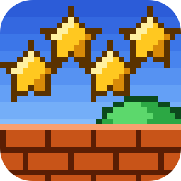
</p>

<h1 align="center">Super Mario All-Stars, native for Mac, Windows, Linux and Android</h1>

<p align="center">
  The 1993 Super Nintendo collection (Super Mario Bros., The Lost Levels, Super Mario Bros. 2 and 3),<br>
  rebuilt as a real program for your computer. Crisp pixels at any size, a proper launcher, controller support, and cheats.<br>
  <b>Free. Bring your own copy of the game.</b>
</p>

**Website:** [supermarioallstars.tanookistudios.com](https://supermarioallstars.tanookistudios.com)

## Download

| Your computer | Download | |
|---|---|---|
| **Mac** (Apple chip or Intel, macOS 11+) | [**SuperMarioAllStars-Mac.zip**](https://github.com/TanookiStudios/SuperMarioAllStarsRecomp/releases/latest/download/SuperMarioAllStars-Mac.zip) | Signed and notarized by Apple |
| **Windows** (64-bit) | [**SuperMarioAllStars-Windows.zip**](https://github.com/TanookiStudios/SuperMarioAllStarsRecomp/releases/latest/download/SuperMarioAllStars-Windows.zip) | |
| **Linux** (64-bit, most desktops from 2020 on) | [**SuperMarioAllStars-Linux.tar.gz**](https://github.com/TanookiStudios/SuperMarioAllStarsRecomp/releases/latest/download/SuperMarioAllStars-Linux.tar.gz) | |
| **Android** (64-bit phones and tablets, Android 7+) | [**SuperMarioAllStars-Android.apk**](https://github.com/TanookiStudios/SuperMarioAllStarsRecomp/releases/latest/download/SuperMarioAllStars-Android.apk) | Not on Google Play: install the APK |

Every version and its notes are on the [Releases page](https://github.com/TanookiStudios/SuperMarioAllStarsRecomp/releases).

## How to play

1. Download the version for your computer and unzip it.
   - **Mac:** drag **Super Mario All-Stars** into Applications (or anywhere) and double-click it.
   - **Windows:** open the folder and double-click **SuperMarioAllStars.exe**.
   - **Linux:** open the folder and double-click **SuperMarioAllStars** (or run `./SuperMarioAllStars`).
   - **Android:** open the downloaded **SuperMarioAllStars-Android.apk**. If Android asks, allow your browser or
     file app to install apps ("Install unknown apps"), then tap **Install**. The first time you open it, tap
     **Choose file** and pick your game file (a `.zip` with it inside works too).
2. The launcher asks for your game file. Pick your own **Super Mario All-Stars (USA)** `.sfc` file.
   The launcher checks it and shows **ROM verified** when it's the right one.
3. Set any options you like (the **Game** button has the cheats and sound switches), then press **Play**.
   Pick a game on the cartridge's own Select Game screen, just like on the console.

No game files come with this download. You need your own copy of the cartridge's data. The one that works is:

| | |
|---|---|
| Game | Super Mario All-Stars (USA) |
| SHA-256 | `411c7036750fbc79d60b84602414dbe713074de8204d3c4a5ad762679c103c61` |

### Controls

| SNES | Keyboard |
|---|---|
| D-pad | Arrow keys |
| B | Z |
| A | X |
| Y | A |
| X | S |
| L | C |
| R | V |
| Start | Enter |
| Select | Right Shift |
| **Menu** | **Esc** |

**On Android** an on-screen SNES controller sits beside the picture (it hides while a controller is
connected), and the ☰ button, the Back gesture or a controller's Home button opens the menu: cheats,
sound, save and load states, reset, About.

**Controllers:** plug one in and play, no setup. Xbox, PlayStation (3, 4 and 5), Switch Pro and Joy-Con,
8BitDo, and over 2,000 other pads are recognized by name. Any other USB pad still works with a standard layout.
The keyboard keeps working alongside the first controller; a second controller plays as player 2. Everything
can be remapped in **Settings**, and the **Esc** menu opens from a controller with the Guide / Home button
(or Select plus a click of the left stick). Own mappings: put a `gamecontrollerdb.txt` in the settings folder
(Mac: `~/Library/Application Support/SuperMarioAllStars`, Windows and Linux: next to the program).

## What's in it

- **A real app.** It runs as a real Mac, Windows or Linux program, not an emulator window. Super Mario Bros. and The Lost Levels
  are mostly translated into native code; Super Mario Bros. 2 and 3 run the game's original code in a built-in
  interpreter, at full speed.
- **Crisp at any size.** Whole-number scaling keeps every pixel sharp, from a small window to a 4K screen.
- **Launcher.** Set everything before you play: display, sound, controls, cheats.
- **In-game menu (Esc).** Change settings, save and load states, reset the game, or close it.
- **Sound.** Volume, and a mute switch for each of the Super Nintendo's eight sound voices.
- **Cheats.** Infinite lives (all four games), stop the clock (Super Mario Bros., The Lost Levels, Super Mario Bros. 3),
  full hearts (Super Mario Bros. 2), and start every level powered up (Fire Mario, or Raccoon Mario in Super Mario Bros. 3).

## Screenshots

<p>
  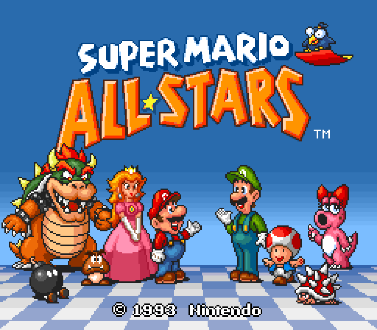
  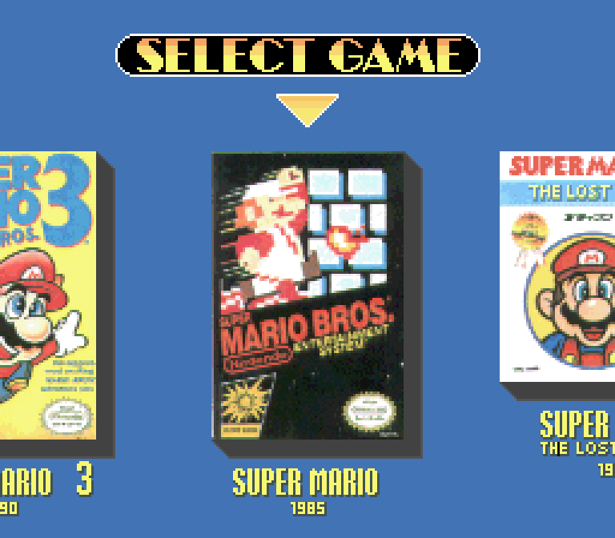
  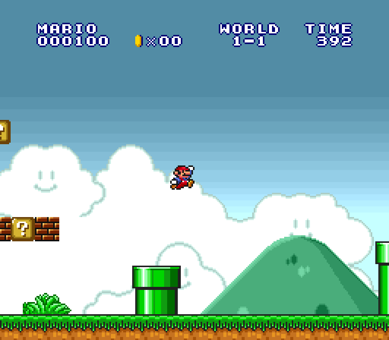
</p>
<p>
  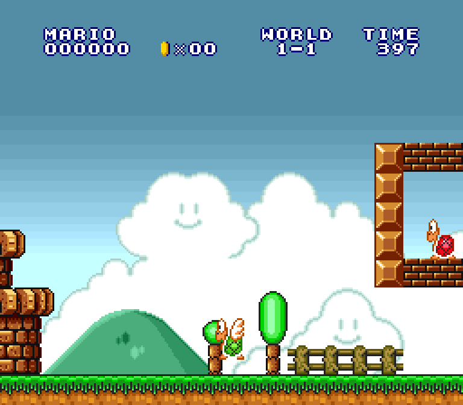
  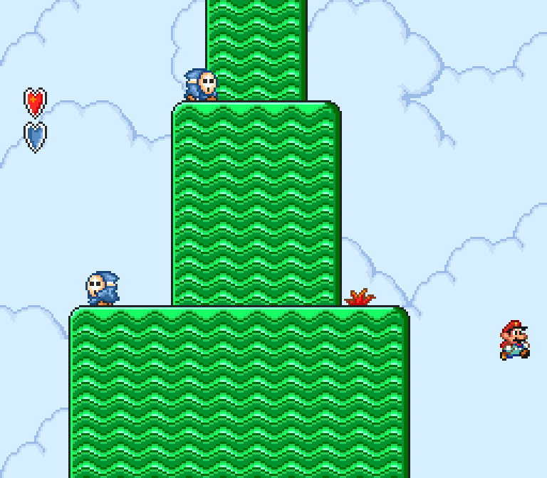
  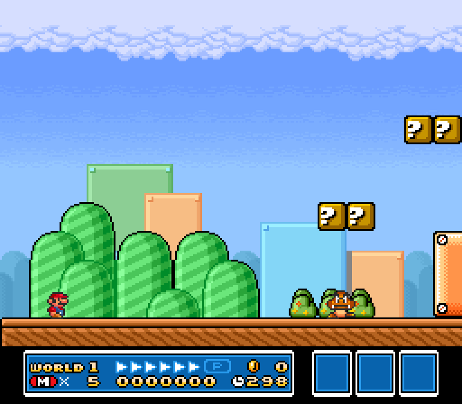
</p>
<p>
  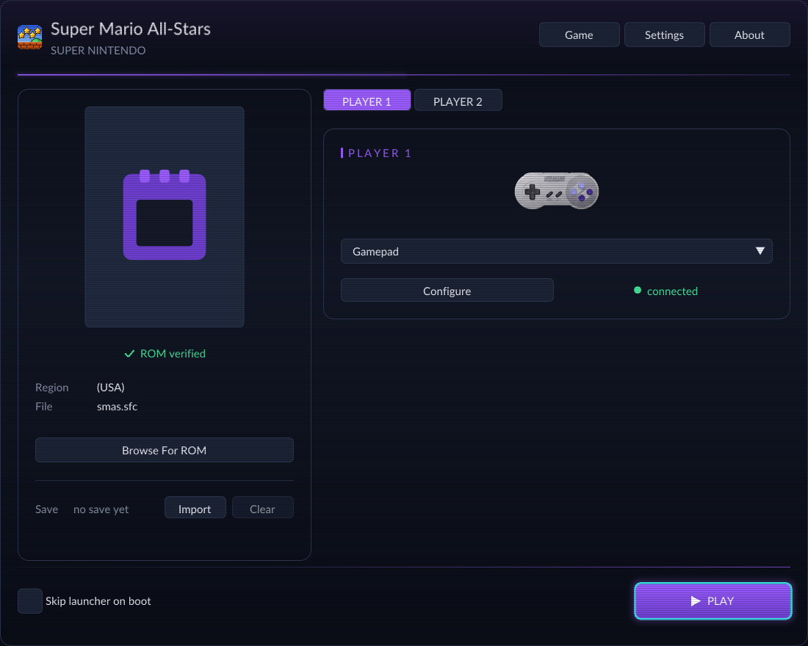
  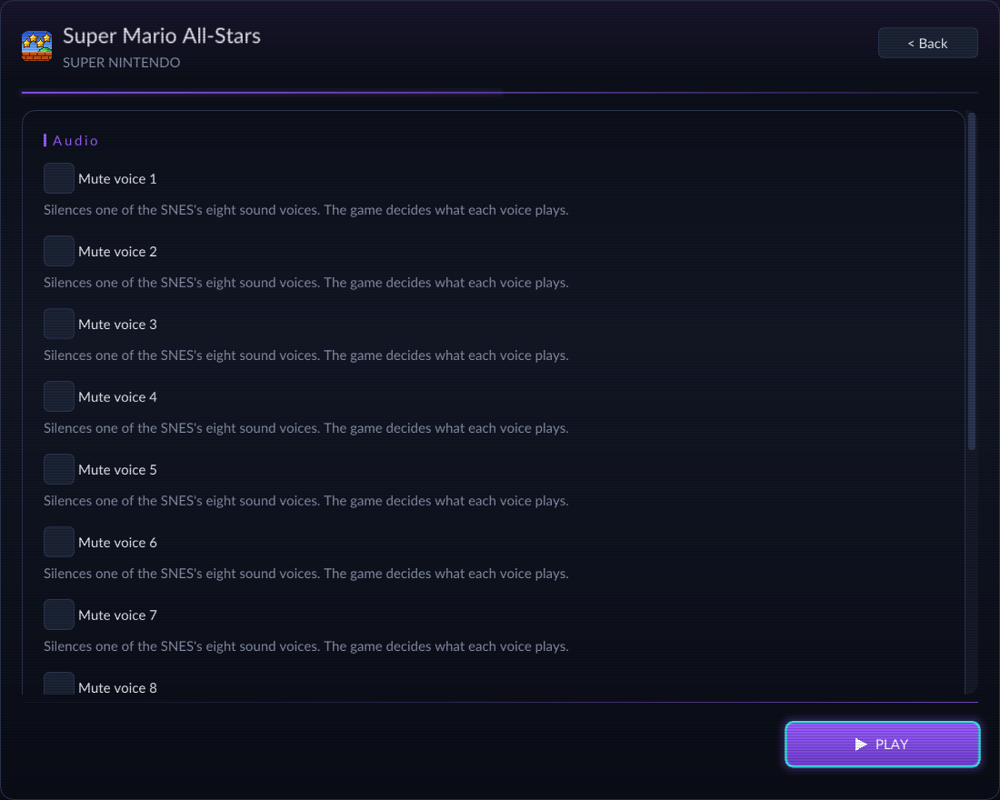
</p>
<p>
  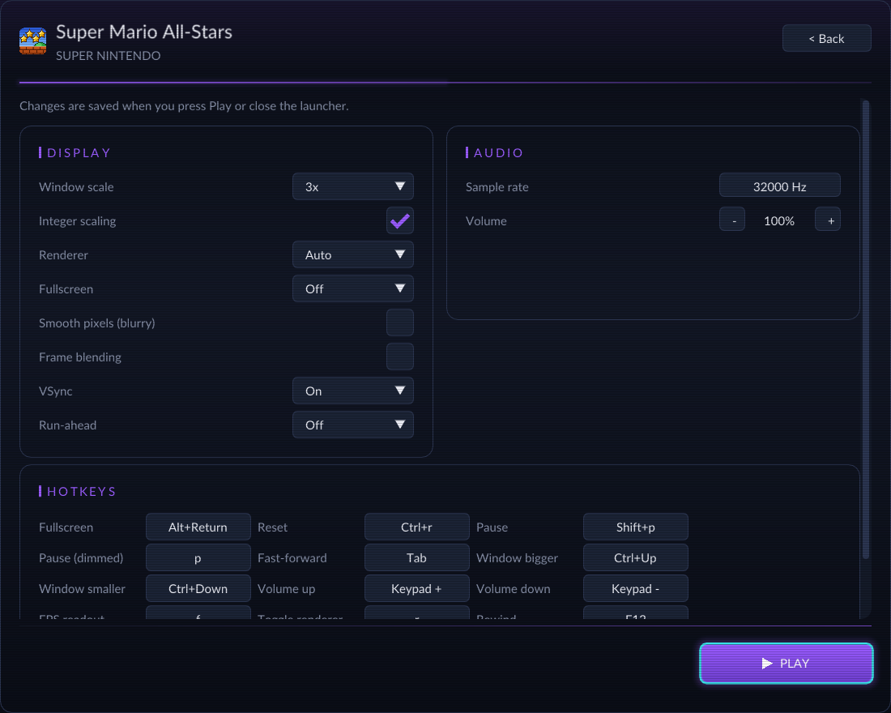
  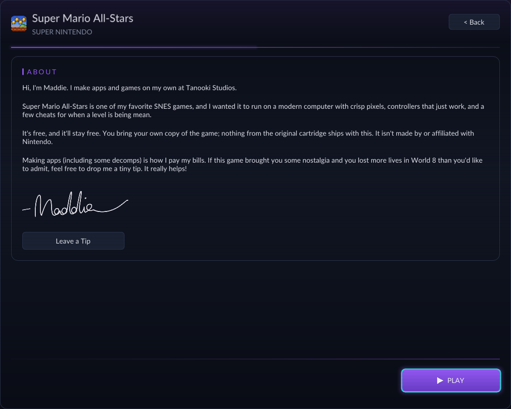
</p>
<p>
  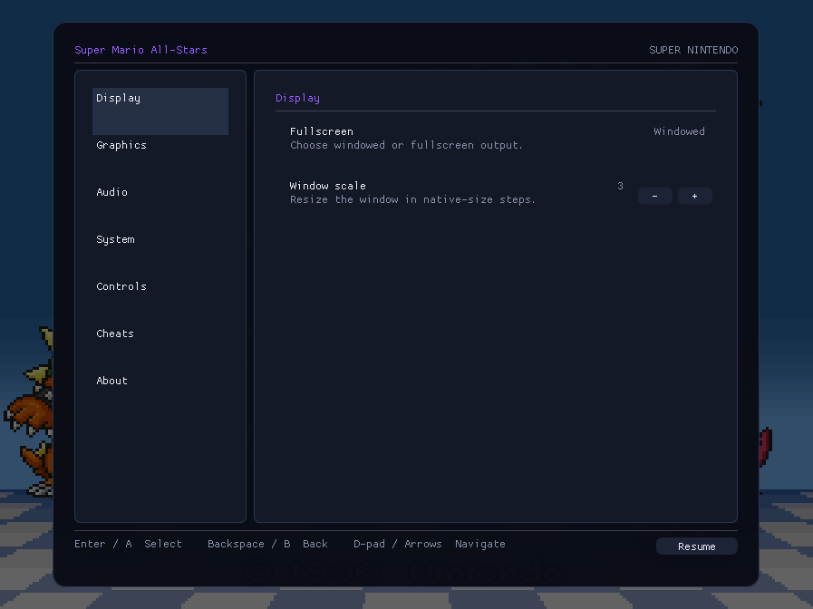
  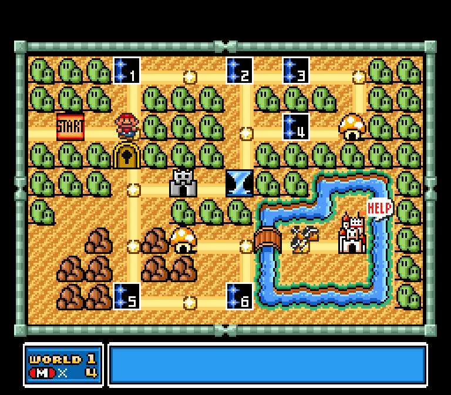
</p>

## Building it yourself

You need your own ROM for this too: the build reads it to translate the game, and nothing from it is stored in this repository.

```sh
./setup.sh                                  # fetches the engine at the tested versions and applies patches/
cp "/path/to/Super Mario All-Stars (USA).sfc" rom/smas.sfc
bash tools/regen.sh                         # translates your ROM into C (kept out of git)
cmake -S . -B build -G Ninja -DCMAKE_BUILD_TYPE=Release
cmake --build build
```

Android: `tools/make_android.sh` (signed release APK; the Gradle project is in `android/`).
Release builds: `tools/make_app.sh --notarize` (Mac), `tools/make_windows_zip.sh` (Windows, cross-built on a Mac),
`tools/make_linux.sh` (Linux, built in an Ubuntu 20.04 container). Screenshots: `tools/capture-screenshots.sh`.

## About Maddie

Hi, I'm Maddie. I make apps and games on my own at [Tanooki Studios](https://tanookistudios.com).

Super Mario All-Stars is one of my favorite SNES games, and I wanted it to run on a modern computer with crisp pixels,
controllers that just work, and a few cheats for when a level is being mean.

It's free, and it'll stay free. Making apps (including some decomps) is how I pay my bills. If this game brought you some nostalgia and you lost more lives in World 8 than you'd like to admit, feel free to drop me a tiny tip. It really helps!


**[Leave a Tip](https://tanookistudios.com/SupportMe)**

## Credits and legal

- Built on [snesrecomp](https://github.com/mstan/snesrecomp) by Matthew Stanley (PolyForm Noncommercial 1.0.0)
  and [recomp-ui](https://github.com/mstan/recomp-ui) (MIT), with [SDL](https://libsdl.org) (zlib) and
  [Dear ImGui](https://github.com/ocornut/imgui) (MIT), and the [SDL_GameControllerDB](https://github.com/mdqinc/SDL_GameControllerDB) controller list (zlib). Full texts: [THIRD_PARTY_NOTICES.md](THIRD_PARTY_NOTICES.md).
- This project's own code is under the [PolyForm Noncommercial License 1.0.0](LICENSE). It may never be sold.
- Super Mario All-Stars, Super Mario Bros., Mario and Super Nintendo are trademarks of Nintendo, which published the game.
  This project is not made by, endorsed by, or affiliated with Nintendo. It contains no game data: you supply your own.
